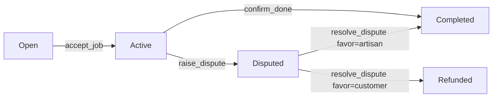

# OwoWork Soroban Contract

A Soroban smart contract for job escrow and artisan reputation tracking.

## Module Organization

The contract is organized into modular components for better maintainability and separation of concerns:

### `src/lib.rs`
- Main contract entry point
- Contains the `JobEscrow` contract struct and implementation
- Exports all public modules

### `src/constants/`
- Contract configuration and storage keys
- Event symbols and error messages
- Time constants (e.g., dispute TTL)

### `src/state/`
- Data structures and enums
  - `JobState`: Job lifecycle states (Open, Active, Disputed, Completed, Refunded)
  - `Job`: Complete job record with all metadata
  - `Reputation`: Artisan reputation tracking with helper methods

### `src/storage/`
- Persistent storage access patterns
  - `JobStorage`: CRUD operations for job records
  - `ReputationStorage`: Reputation management

### `src/test.rs`
- Comprehensive test suite
- Example test cases for all contract functions
- Mock authentication and environment setup

## Build Instructions

### Prerequisites
```bash
rustup target add wasm32-unknown-unknown
```

### Build Commands

**Using Cargo directly:**
```bash
# Build for WASM target
cargo build --target wasm32-unknown-unknown --release

# Run tests
cargo test

# Check for warnings
cargo check
```

**Using provided scripts:**

**Windows:**
```bash
build.bat
```

**Unix/Linux/Mac:**
```bash
chmod +x build.sh
./build.sh
```

### Build Artifacts
- WASM file: `target/wasm32-unknown-unknown/release/owowork_contract.wasm`
- Test output: Run with `cargo test`

## Contract Functions

### State-Changing Functions (require authentication)
1. `create_job` - Customer creates a job (requires customer auth)
2. `accept_job` - Artisan accepts a job (requires artisan auth)
3. `confirm_done` - Customer confirms completion (requires customer auth)
4. `raise_dispute` - Customer raises dispute (requires customer auth)
5. `resolve_dispute` - Mediator resolves dispute (requires mediator auth)

### Read-Only Functions
1. `get_job` - Read job record by ID
2. `get_reputation` - Read artisan reputation

## State Machine



## Storage Keys

- Jobs: `(JOB, job_id)` where `JOB = symbol_short!("JOB")`
- Reputation: `(REP, artisan_address)` where `REP = symbol_short!("REP")`

## Events

The contract emits events for all state changes:
- `created` - Job created
- `accepted` - Job accepted by artisan
- `completed` - Job completed successfully
- `disputed` - Dispute raised
- `resolved` - Dispute resolved

## Error Handling

The contract uses clear error messages for validation failures:
- `job already exists` - Duplicate job creation
- `job not found` - Non-existent job access
- `job not open/active/disputed` - Invalid state transitions
- `wrong artisan/customer` - Authentication mismatch
- `48h window not elapsed yet` - Early dispute resolution

## Security Features

1. **Authentication**: All state-changing functions require caller authentication
2. **Role-based access**: Functions verify the caller matches expected role
3. **State validation**: Enforces valid state transitions
4. **Time-based constraints**: Dispute resolution requires 48-hour window
5. **Duplicate prevention**: Unique job IDs enforced

## Testing

Run the comprehensive test suite:
```bash
cargo test
```

Tests cover:
- Happy path workflow (create → accept → complete)
- Dispute resolution workflow
- Error conditions (duplicate jobs, wrong roles)
- Reputation tracking
- Event emission

## Deployment

After building, deploy using Soroban CLI:
```bash
soroban contract deploy \
  --wasm target/wasm32-unknown-unknown/release/owowork_contract.wasm \
  --source <DEPLOYER_ACCOUNT> \
  --network testnet
```